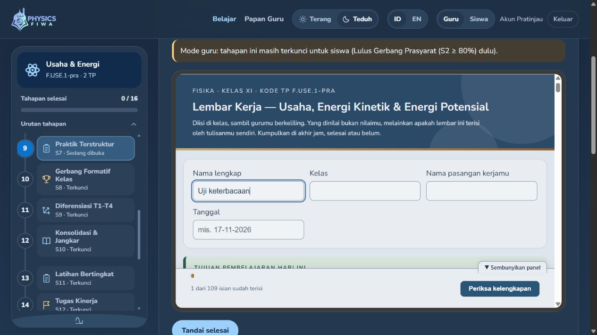
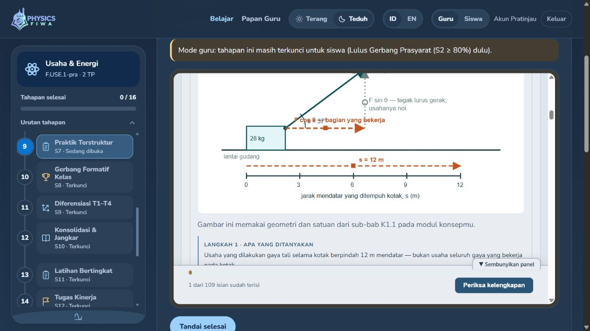
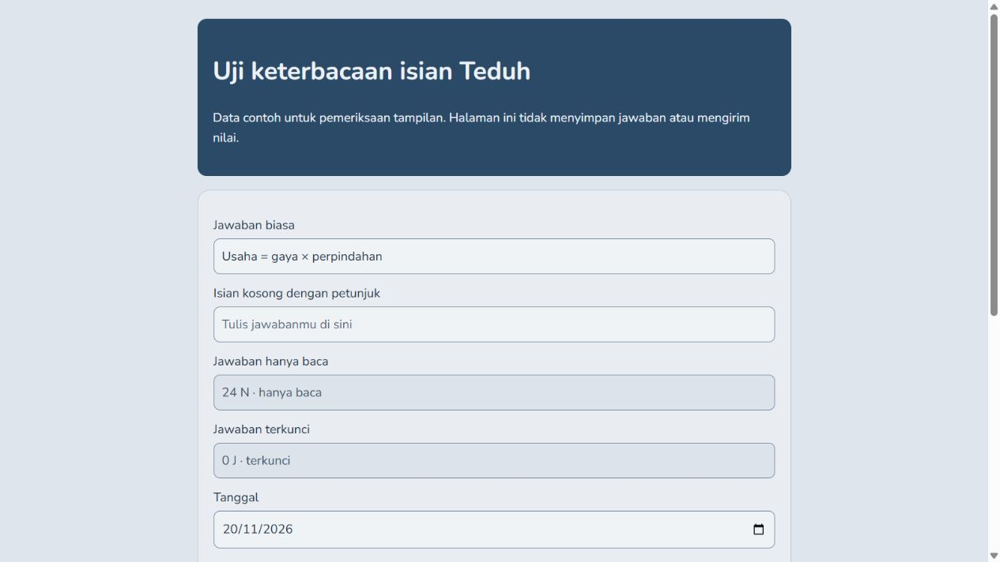

# Hasil pemeriksaan keterbacaan Teduh

Tanggal 20 November 2026. Pemeriksaan berlangsung pada pratinjau loopback dengan akun guru dan data contoh, bukan situs produksi.

## Kontras teks yang terhitung

Warna teks dibaca dari gaya terhitung di peramban dan dibandingkan dengan latar solid terdekat. Sampel meliputi teks yang mempunyai bidang tata letak serta input/select/textarea; skrip, elemen tersembunyi dan isi gambar dikecualikan. Rasio dihitung dari luminans relatif sRGB. Ini pemeriksaan sampel tampilan, bukan audit aksesibilitas seluruh situs.

| Dokumen dan keadaan | Sampel teks/isian | Rasio minimum | Sampel di bawah 4,5:1 |
| --- | --- | --- | --- |
| F.USE S7 | 371 | 5.08:1 | 0 |
| F.MEK S7 | 150 | 5.5:1 | 0 |
| F.USE S13 | 123 | 5.09:1 | 0 |
| PRI SMP penyisihan | 32 | 5.5:1 | 0 |
| F.USE S11 | 273 | 5.09:1 | 0 |
| PRI SMP saat pengerjaan | 580 | 5.5:1 | 0 |
| PRI SMP opsi terpilih setelah koreksi | 580 | 5.5:1 | 0 |
| PRI SMP ditandai ragu | 580 | 5.48:1 | 0 |
| PRI SMP hasil dan lembar terkunci | 1309 | 5.09:1 | 0 |
| Kontrol normal, readonly, disabled, placeholder dan invalid | 22 | 5.5:1 | 0 |
| F.USE S7 final | 371 | 5.08:1 | 0 |
| F.MEK S7 final | 150 | 5.5:1 | 0 |
| F.USE S13 final | 123 | 5.09:1 | 0 |
| F.USE S11 final | 273 | 5.09:1 | 0 |

Placeholder diukur terpisah: 4.99:1. Rasio teks utama terendah pada sampel dokumen sekitar 5,08:1. Pemeriksaan awal menemukan header soal yang terisi masih memakai tinta terang pada latar pucat; aturan tersebut diperbaiki, lalu kondisi terpilih, ragu dan hasil terkunci diperiksa ulang.

## Pemeriksaan perilaku

- Jawaban contoh Uji keterbacaan tetap utuh setelah pergantian Terang dan Teduh; iframe tidak dimuat ulang oleh penggantian tema.
- Input biasa, placeholder, tanggal, select, textarea, readonly, disabled dan invalid diperiksa melalui [halaman kontrol uji](ISIAN-UJI.html). Kondisi readonly/disabled memakai bidang sedikit lebih gelap; invalid memakai bidang hangat dan tepi yang jelas.
- Label, tabel, opsi soal, bilah bawah serta pembahasan diperiksa pada dokumen perwakilan.
- Diagram tetap mempunyai warna sumbernya; tidak dipakai filter invert atau brightness pada seluruh halaman.
- Sintaks tema.js valid; 16 pemeriksaan logika antarmuka yang sudah ada tetap lulus.
- Seluruh 155 berkas HTML sumber selain index.html tetap identik dengan inventaris awal, termasuk dokumen soal. Pembaruan aplikasi sesi ini hanya assets/tema.js dan assets/tema-konten.css.

## Bukti visual

Data pengukuran tersimpan di [hasil-peramban.json](hasil-peramban.json). Gambar menggunakan data contoh.

## Cakupan

Pemeriksaan ini meliputi lima dokumen perwakilan pada ukuran jendela desktop yang tersedia dan kontrol uji terpisah. Seluruh halaman, perangkat, PDF dan sumber luar belum diuji satu per satu. Tidak ada penerbitan atau perubahan data produksi.
